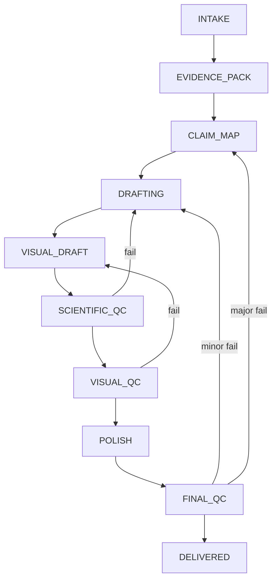

# State Machine

## Transition Rules

| From | To | Allowed When |
|---|---|---|
| `INTAKE` | `EVIDENCE_PACK` | task brief is complete |
| `EVIDENCE_PACK` | `CLAIM_MAP` | evidence and data context are traceable |
| `CLAIM_MAP` | `DRAFTING` | each claim has supporting evidence or data |
| `DRAFTING` | `VISUAL_DRAFT` | section drafts are complete enough for figure planning |
| `VISUAL_DRAFT` | `SCIENTIFIC_QC` | draft visuals and plotting package are complete |
| `SCIENTIFIC_QC` | `VISUAL_QC` | scientific gate passes |
| `VISUAL_QC` | `POLISH` | visual gate passes |
| `POLISH` | `FINAL_QC` | language is refined without scientific changes |
| `FINAL_QC` | `DELIVERED` | final gate passes |

## Rollback Rules

- `SCIENTIFIC_QC` failure returns to `DRAFTING`
- `VISUAL_QC` failure returns to `VISUAL_DRAFT`
- `FINAL_QC` minor failure returns to `DRAFTING`
- `FINAL_QC` major failure returns to `CLAIM_MAP`

## Blocked State

If three consecutive revisions fail for the same gate, the workflow enters a manual review checkpoint owned by the `master-agent`.
